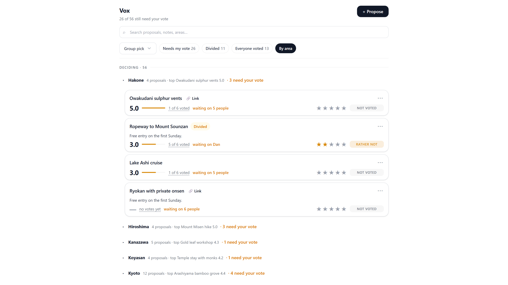
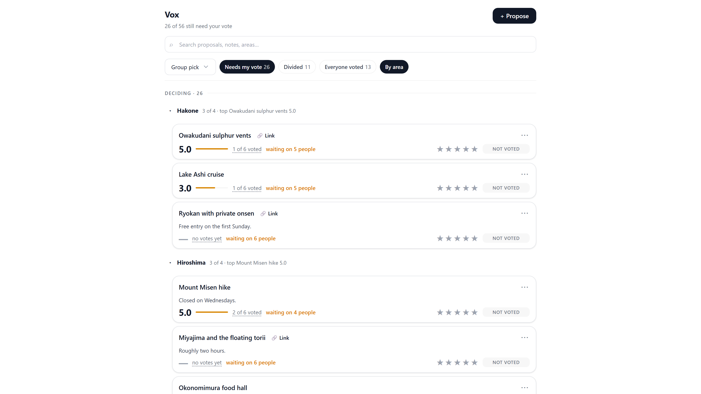
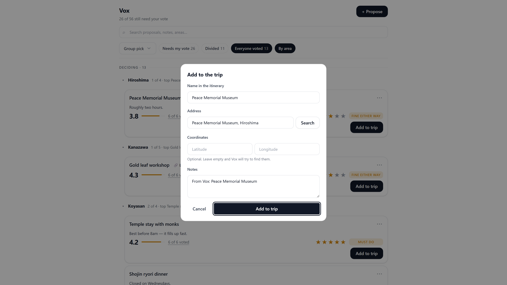
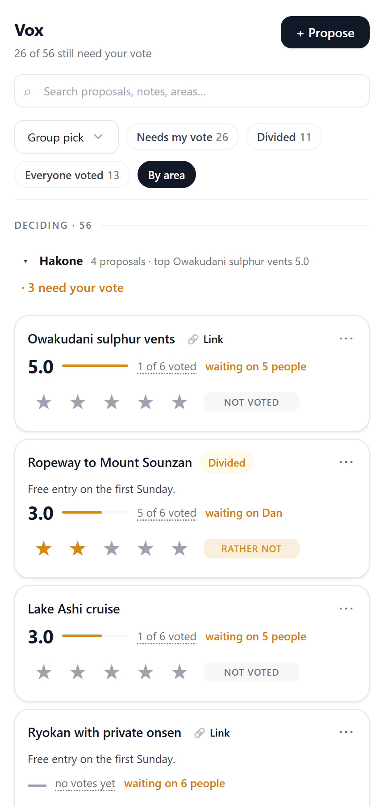
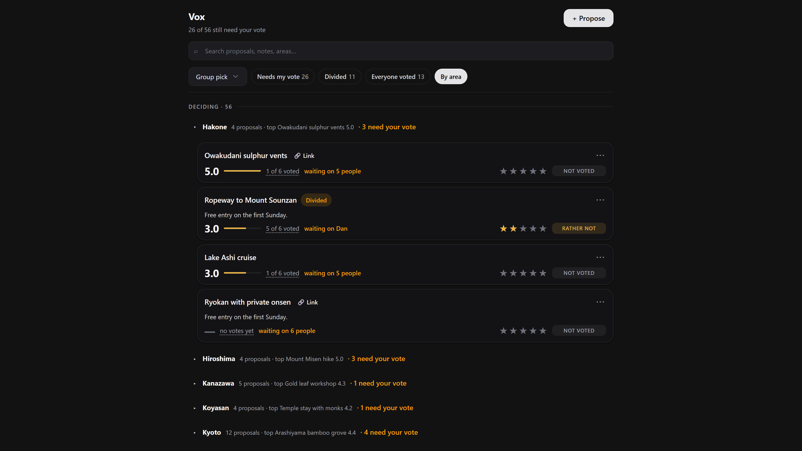

# Vox — decide together what the trip actually does

A trip with friends usually has more ideas than days. Vox is the tab where the group
sorts that out: anyone proposes something, everyone rates it, and the things the group
actually wants rise to the top and go straight into the itinerary.



## What it does

**Proposals, not a wishlist.** Anyone in the trip adds an activity with a title, a note
and a link. It lands in the "Deciding" list, and every member can rate it from 1 to 5.
Hovering — or tapping — a star tells you what that rating means: *Must do*, *Keen*,
*Fine either way*, *Rather not*, *Really not*. The label is there because a bare star
count hides the useful half of the scale; a single "Really not" is a person who will
put up with their day rather than enjoy it, and the group should see that.

**A ranking that has to be earned.** The number on a card is the plain average of what
people said. The *order* is not: it uses a mean pulled toward the neutral middle, so a
proposal has to collect votes to climb. A 5.0 from one person sits below a 4.5 from
six — see [How the ranking works](#how-the-ranking-works).

**Turnout with names on it.** Instead of a participation percentage, a card says
"5 of 6 voted" and, when someone is holding things up, "waiting on Dan". Click the
turnout and you get the full breakdown: who rated what, and who has not answered.

**A flag for the thing you need to talk about.** When a proposal has both fans and
objectors — someone at 4 or 5, someone at 1 or 2 — it gets a **Divided** badge. That is
worth a conversation in a way an agreement score never is.

**Areas, for a trip that goes places.** Proposals can be grouped under a free-text
label: a city, a region, a day. Past a handful of areas Vox folds them into a summary
index — *Kyoto · 12 proposals · top Arashiyama bamboo grove 4.4 · 4 need your vote* —
so you can see a hundred proposals at a glance and open the one you want to work on.

**Search and lenses, for when the list gets long.** A search box over titles, notes and
areas, plus three filters that answer the questions people actually have: *Needs my
vote*, *Divided*, *Everyone voted*. They combine with the grouping, so you can work
through your own backlog area by area.

**The decision lands in TREK.** Once everyone has voted, a card offers **Add to trip**:
Vox creates a real place in the trip's itinerary, geocoding the address if it can and
adding it without coordinates if it cannot. Those proposals move to an "In the trip"
section, which is the visible record of what the group settled on. Delete that place
from the itinerary later and Vox notices, putting the proposal back up for decision.

**One request per screen.** The whole board — proposals, votes, roster, areas — arrives
in a single call, so searching, filtering and sorting are instant and never hit the
network.

## Screenshots

**Your own backlog.** The *Needs my vote* lens, still grouped by area, so you can clear
one place at a time.



**Handing a decision to the itinerary.** *Everyone voted* surfaces what is ready to
settle; **Add to trip** turns it into a real place, address prefilled and searchable.



**On a phone.** The card stays one tap deep, and the stars grow to a proper tap target.



**Dark.** Vox uses TREK's own design tokens, so it follows your theme, your accent and
your contrast settings rather than approximating them.



## How the ranking works

Sorting by raw average puts a proposal with one enthusiastic vote above one the whole
group likes. Vox ranks on a shrunk mean instead:

```
rank = (votes × average + 2 × 3) ÷ (votes + 2)
```

Every proposal starts as if it held two neutral votes, and real votes pull it away from
the middle. Nothing new is stored — it is computed from the votes on every read.

| Proposal | Votes | Average | Rank score |
|---|---|---|---|
| Fushimi Inari | 5, 5, 5, 4, 4 | **4.6** | **4.14** |
| Dotonbori at night | 5, 5, 4 | **4.7** | 4.00 |
| Nishiki Market | 5, 5, 4, 2, 1, 1 | 3.0 | 3.00 |
| Nobody's idea | 1 | 1.0 | 2.33 |

Dotonbori has the better average and still ranks second: three voices are not five. A
proposal nobody has rated sits at the neutral 3.0 — it claims nothing until someone
speaks. You can always switch the sort to *Most votes*, *Newest* or *Most divided*.

## Permissions

| Permission | Why it is needed |
|---|---|
| `db:own` | Keeps the plugin's own data — proposals, votes, area labels — in a private SQLite database, scoped per trip. Nothing is written to TREK's own tables. |
| `db:read:trips` | Reads the trip's member roster, so Vox knows how many people a vote is waiting on and can name who has not voted yet. Also reads the trip's places, to notice when one that came from Vox has since been deleted by hand. |
| `db:read:users` | Reads one display name: the trip owner's. TREK never stores the owner in the member table, so they are missing from the roster a plugin can read — without this the owner would not be counted in a vote, and their own rating would show as an unknown name. |
| `db:write:places` | Adds the activity the group picked to the trip's itinerary as a real place. |
| `http:outbound:nominatim.openstreetmap.org` | Turns an address into coordinates when you add a pick to the itinerary, using OpenStreetMap's Nominatim (free, no API key). It is best-effort: if the lookup fails, the place is still added, just without a map pin. |

Every read is membership-checked by TREK against the person making the request, and
every write goes through the same permission checks as the web UI. Vox never deletes a
place from your itinerary.

## Setup

1. Requires **TREK 3.3.0+** — that is the version that lets a plugin read a trip's
   member roster, which is what Vox counts a vote against. Install Vox from the plugin
   store (Admin → Plugins → Discover) and activate it, approving the permissions above.
2. Open any **trip**. Vox appears as a tab inside it, scoped to that trip.
3. Hit **+ Propose** and add the first activity. Give it an area if the trip covers more
   than one place — you can create one from the same form.
4. Tell the group. Everyone with access to the trip can rate everything; the header
   tells each person how many proposals are still waiting on them.
5. When a proposal shows **6 of 6 voted**, hit **Add to trip**. It becomes a real place
   in the itinerary, and moves to the "In the trip" section.

Who can remove a proposal: its author, or the trip owner. If the author has left the
trip, any member can — otherwise their proposals would be stuck there forever. Editing
stays open to everyone, because a shared proposal is the point.

## Upgrading from 1.x

2.0.0 is a rewrite of both the screen and the HTTP routes. Your data is untouched —
proposals, votes and areas keep their tables and their contents, and no migration runs.
Two things change for the people using it: the two tabs became one screen, and the
"consensus" percentage is gone. It rewarded agreement over enthusiasm and, at one vote,
reported perfect agreement — which put whatever nobody wanted at the top of the list.
The **Divided** badge and the turnout count replace it.

## License

MIT License

Copyright (c) 2026 Maxime Cn

Permission is hereby granted, free of charge, to any person obtaining a copy
of this software and associated documentation files (the "Software"), to deal
in the Software without restriction, including without limitation the rights
to use, copy, modify, merge, publish, distribute, sublicense, and/or sell
copies of the Software, and to permit persons to whom the Software is
furnished to do so, subject to the following conditions:

The above copyright notice and this permission notice shall be included in all
copies or substantial portions of the Software.

THE SOFTWARE IS PROVIDED "AS IS", WITHOUT WARRANTY OF ANY KIND, EXPRESS OR
IMPLIED, INCLUDING BUT NOT LIMITED TO THE WARRANTIES OF MERCHANTABILITY,
FITNESS FOR A PARTICULAR PURPOSE AND NONINFRINGEMENT. IN NO EVENT SHALL THE
AUTHORS OR COPYRIGHT HOLDERS BE LIABLE FOR ANY CLAIM, DAMAGES OR OTHER
LIABILITY, WHETHER IN AN ACTION OF CONTRACT, TORT OR OTHERWISE, ARISING FROM,
OUT OF OR IN CONNECTION WITH THE SOFTWARE OR THE USE OR OTHER DEALINGS IN THE
SOFTWARE.
